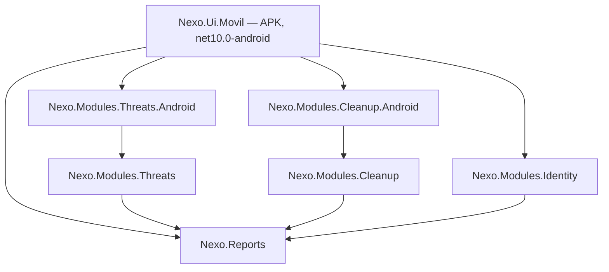

# Versión Android — Nexo Móvil

> Idea nueva del 2026-11-16: llevar Nexo al celular Android como una app (APK) que haga «lo mismo que en Windows y Linux».
> Sigue el contrato de [[Salida 0 - Arquitectura general del sistema]] y reutiliza lo portable de [[Salida 4 - Modulo de limpieza y optimizacion]] y [[Salida 5 - Modulo de reportes y visualizacion]]. La viabilidad general del proyecto está en [[Salida 6 - Analisis de viabilidad del proyecto]].
> **Estado: solo diseño.** No hay código todavía. Las afirmaciones sobre APIs de Android marcadas *(por verificar)* se comprueban en la fase 0, en un emulador y en un teléfono real.

---

## 0. La decisión que gobierna todo el módulo

En Windows, Nexo corre en modo usuario y por eso **detecta y reacciona, pero no previene** ([[Salida 0 - Arquitectura general del sistema]] §0.2). En Android el límite es más estricto: **cada app vive en su propia caja (sandbox)** y ninguna app normal, sin root, puede mirar dentro de las demás.

| Quiero… | Una app de Android sin root puede | Comentario |
|---|---|---|
| Saber qué apps hay instaladas, sus permisos y de dónde vienen | **Sí** | `PackageManager`; exige declarar `QUERY_ALL_PACKAGES` |
| Leer el APK de cada app instalada y calcular su huella | **Sí** | Los APK instalados son legibles *(por verificar en Android 14+)* |
| Leer los archivos privados de otra app | **No** | Es la base de la seguridad de Android |
| Impedir que se instale una app | **No** | Solo enterarse después y avisar |
| Desinstalar otra app | **Solo pidiéndoselo al usuario** | Android muestra su propio diálogo de confirmación |
| Bloquear el internet de una app | **Sí**, con una VPN local | Ver §3.6 |
| Vaciar la caché de otras apps | **No** (desde Android 6) | Solo se puede mostrar cuánto ocupan y abrir sus ajustes |
| Leer el estado del almacenamiento interno (tipo S.M.A.R.T.) | **No** | El teléfono no lo expone |
| Leer los SMS | Técnicamente sí, pero **no lo hacemos** | Google Play lo reserva a la app de SMS por defecto, y es invasivo |

**Consecuencia honesta:** Nexo Móvil es un **auditor y detector**: revisa las apps y la configuración del teléfono, avisa de lo que se ve mal y guía al usuario para corregirlo. No es un escudo que bloquea antes de que algo ocurra. Ningún antivirus de Android sin root lo es, aunque lo digan en la publicidad.

Igual que en Windows Nexo **complementa a Defender**, en Android **complementa a Google Play Protect**: no lo reemplaza ni pide desactivarlo.

---

## 1. Decisiones de base (y por qué)

### 1.1 .NET para Android + Avalonia, no Kotlin

| Opción | A favor | En contra |
|---|---|---|
| **.NET 10 para Android + Avalonia 11.3** ✅ | Mismo lenguaje (C#) y mismo tema Classic que el escritorio. Se reutilizan tal cual `Nexo.Reports`, `Nexo.Modules.Threats` (enlaces, phishing, QR, Wi-Fi, VPN), la bóveda y las filtraciones de `Nexo.Modules.Identity` y los duplicados de `Nexo.Modules.Cleanup`. Las APIs de Android se llaman desde C# con los enlaces oficiales | APK más pesado (≈30–50 MB). Hay menos ejemplos en internet que para Kotlin. Avalonia en Android es menos maduro que en escritorio (lo comprueba la fase 0) |
| Kotlin nativo | Es lo normal en Android y tiene mucha documentación | Habría que reescribir en otro lenguaje todo lo portable. Para un proyecto de una persona es el camino más rápido al abandono, el mismo argumento de [[Salida 0 - Arquitectura general del sistema]] §0.1 |
| .NET MAUI | También es C# | La UI es otra (no hay tema Classic) y no se comparte con la ventana de escritorio, que ya es Avalonia |

**Sobre la versión de .NET:** el soporte de .NET 8 terminó el 2026-11-10. La app de Android se crea directamente en **`net10.0-android`** (.NET 10 es LTS). Las librerías portables, que hoy son `net8.0`, se pueden consumir desde .NET 10 sin cambios. Mover también el escritorio a .NET 10 queda como tarea aparte.

### 1.2 Sin servicio aparte ni named pipe

En Windows hay dos procesos (servicio como `LocalSystem` + ventana del usuario) porque el servicio tiene privilegios que la ventana no. En Android **no existe esa diferencia**: la app tiene sus permisos y nada más. Por eso:

- Todo corre **en el mismo proceso**. No hace falta `Nexo.Ipc` ni el pipe.
- El trabajo periódico (revisar apps nuevas, actualizar listas) lo agenda **WorkManager**, que Android respeta aunque la app esté cerrada.
- Solo el firewall (§3.6) necesita algo vivo todo el tiempo: el `VpnService`, que Android mantiene con una notificación fija.

### 1.3 Se mantiene «vista previa + token», con la huella en lugar del UAC

La regla de la casa no cambia: **nada destructivo sin vista previa y confirmación** (ver [[Salida 4 - Modulo de limpieza y optimizacion]] §4). Lo que en Windows aprueba el UAC desde la bandeja, en Android lo aprueba **`BiometricPrompt`** (huella, rostro o el PIN del teléfono). El token sigue ligado al contenido exacto de la vista previa.

### 1.4 Distribución: APK propio primero

- **v1: APK firmado en GitHub Releases.** Sin revisiones de Google ni formularios de permisos.
- **Google Play, quizás después.** Los dos permisos delicados (`QUERY_ALL_PACKAGES` y `MANAGE_EXTERNAL_STORAGE`) están permitidos para antivirus en las políticas de Play, pero exigen llenar una declaración y pasar una revisión.
- **Ojo:** Google anunció que para instalar APKs fuera de Play en teléfonos certificados se exigirá un **desarrollador verificado** (cuenta en la Android Developer Console, con opción para estudiantes y aficionados). Empieza por algunos países en 2026 y se extiende a todo el mundo en 2027 *(por verificar para Chile cuando se publique la primera versión)*.

### 1.5 Versión mínima: Android 11 (API 30)

| API | Desde | Para qué |
|---|---|---|
| `getChangedPackages` | Android 8 (26) | Saber qué apps se instalaron o actualizaron (§3.3) |
| `getInstallSourceInfo` | Android 11 (30) | Saber qué tienda o app instaló cada app (§3.1) |
| Papelera de `MediaStore` (`createTrashRequest`) | Android 11 (30) | Equivalente a la Papelera de Windows (§3.8) |
| `WifiInfo.getCurrentSecurityType` | Android 12 (31) | Wi-Fi sin cifrado (§3.4); en Android 11 se degrada a «sin evaluar» |

Android 11 cubre casi todos los teléfonos en uso, y el almacenamiento con alcance limitado (*scoped storage*) ya está estable en esa versión. Apuntar más abajo obliga a mantener dos caminos de código para el almacenamiento.

---

## 2. Proyectos

Se repite el patrón del escritorio: **la lógica es portable y se prueba en Linux; lo que habla con el sistema va en un proyecto `.Android`**.

| Proyecto | Nuevo o existente | Qué lleva |
|---|---|---|
| `Nexo.Modules.Threats` | Existente, **se amplía** | Carpeta nueva `Apps/`: `ModeloDeApp`, `CatalogoDeSenales` (JSON), `PuntuadorDeRiesgo`, `ListaDeHuellas`, `ChequeoDelEquipo`. Todo portable, sin una línea de Android |
| `Nexo.Modules.Threats.Android` | Nuevo | Lectores: `LectorDeAppsAndroid` (`PackageManager`), `LectorDeAjustes` (bloqueo, parche, depuración USB), `LectorDeWifiAndroid`, `CortafuegosVpn` (`VpnService`), `VigilanteDePaquetes` (WorkManager) |
| `Nexo.Modules.Cleanup.Android` | Nuevo, **fase 3** | Almacenamiento compartido, Papelera de `MediaStore`, tamaños por app |
| `Nexo.Ui.Movil` | Nuevo | La app Avalonia: actividad principal, navegación táctil, notificaciones, `BiometricPrompt`, destino de «Compartir» |
| `tools/Nexo.Movil.Demo` | Nuevo | Pruebas de la lógica portable nueva; corren en Linux como las demás |

**Lo que no se reutiliza tal cual:**

- `GuardiaDeRutas` y `Triturador` usan APIs de Windows. La guardia necesita sus propias listas blanca y negra para rutas de Android; el triturador no se porta (§4).
- De los 20 archivos de `Nexo.Ui.Desktop/Nucleo`, 5 dependen de `Nexo.Ipc`. Los otros 15 son candidatos a compartirse; se decide en la fase 0 si se mueven a un proyecto común o se copian.

---

## 3. Funciones

| # | Función | Fase | Reutiliza |
|---|---|---|---|
| 3.1 | Inventario y riesgo de apps | 1 (MVP) | Modelo de catálogo JSON de limpieza |
| 3.2 | Huellas de malware conocido | 1 (MVP) | Descarga de listas de `AlmacenDeListas` |
| 3.3 | Revisión al instalar o actualizar | 1 (MVP) | — |
| 3.4 | Chequeo del equipo | 1 (MVP) | `ModeloWifi` |
| 3.5 | Enlaces, mensajes y QR por «Compartir» | 2 | Todo `Enlaces/` |
| 3.6 | Firewall por app | 2 | — |
| 3.7 | Bóveda y filtraciones | 3 | Todo `Boveda/` y `Filtraciones/` |
| 3.8 | Almacenamiento y duplicados | 3 | `DetectorDuplicados`, vista previa + token |
| 3.9 | Reportes en Obsidian | 1 (MVP) | `Nexo.Reports` completo |

### 3.1 Inventario y riesgo de apps — **MVP**

Es la función más valiosa en un teléfono: casi todo el malware de Android **es una app que el usuario instaló** y que después abusa de sus permisos.

**Qué se lee de cada app** (`PackageManager` con `GET_PERMISSIONS | GET_SIGNING_CERTIFICATES`):

| Señal | Por qué importa |
|---|---|
| **Servicio de Accesibilidad activo** | Permite leer la pantalla y tocar por el usuario. Es la herramienta favorita de los troyanos bancarios |
| **Administrador del dispositivo activo** | Puede impedir su propia desinstalación |
| Permisos peligrosos **concedidos** (SMS, llamadas, micrófono, cámara, ubicación, contactos) | Que los pida no es grave; que los tenga concedidos sí |
| Superposición de ventanas (`SYSTEM_ALERT_WINDOW`) | Pantallas falsas encima de la app del banco *(leer el estado en apps ajenas: por verificar)* |
| Oyente de notificaciones | Puede leer los códigos de verificación que llegan por notificación *(por verificar)* |
| Puede instalar otras apps (`REQUEST_INSTALL_PACKAGES`) | Es la forma en que un instalador malicioso trae más apps |
| **Origen**: Play Store, otra tienda, navegador o archivo suelto | Una app instalada desde el navegador merece más atención |
| Sin icono en el lanzador | Se esconde del usuario |
| Firmada con certificado de depuración | Nadie publica así una app legítima |

**Puntuación, no veredicto.** Las señales y sus pesos viven en un **catálogo JSON revisable** (`Apps/Datos/senales-de-riesgo.json`), igual que `cleanup-paths.json`: se puede leer de un vistazo sin compilar. El resultado es «**a revisar**» con los motivos en lenguaje simple, nunca «es malware». Las combinaciones pesan más que las señales sueltas: *Accesibilidad + SMS + instalada desde el navegador* es alto; *cámara concedida a la app de la cámara* no es nada.

**Acciones** (las dos las confirma Android, no Nexo):

- «Abrir ajustes de la app», para quitar permisos.
- «Desinstalar»: Nexo pide la desinstalación y Android muestra su diálogo. Si la app es administrador del dispositivo, primero se guía al usuario para quitarle ese rol.

### 3.2 Huellas de malware conocido — **MVP**

- Se calcula el **SHA-256 del APK** de cada app (el base y los *split*). Se guarda en caché por `(paquete, versionCode, lastUpdateTime)` para no rehashear 200 MB en cada revisión.
- Se compara contra una **lista local de huellas de malware Android**. Fuente propuesta: MalwareBazaar (abuse.ch), con datos CC0. Su API exige una clave gratuita.
- **Consulta en línea opcional y apagada por omisión:** solo viaja la huella, nunca el APK ni la lista de apps.
- **Límite honesto:** una huella solo detecta **esa copia exacta**. Una app maliciosa reempaquetada tiene otra huella. Por eso §3.1 es lo principal y esto es un complemento.
- **ClamAV queda fuera en el teléfono:** no hay `clamd`, la base de firmas ocupa cientos de MB y se actualiza a diario.

### 3.3 Revisión al instalar o actualizar — **MVP**

- Desde Android 8, el aviso de «app instalada» (`PACKAGE_ADDED`) **no despierta a una app cerrada**. Por eso se combinan dos caminos:
  - **WorkManager** cada 15 min (el mínimo que permite Android) consulta `getChangedPackages(número)`, que devuelve todo lo que cambió desde la última vez sin que se pierda nada.
  - Un **receptor registrado en ejecución**, para avisar al instante mientras la app está abierta.
- Si la app nueva sale «a revisar» o coincide con una huella → **notificación** con el motivo y el botón «Ver».
- **Riesgo conocido:** algunas marcas (Xiaomi, Huawei, Samsung en modo ahorro) matan las tareas en segundo plano. La app lo detecta (última revisión hace más de 24 h) y explica cómo excluir a Nexo del ahorro de batería.

### 3.4 Chequeo del equipo — **MVP**

Una lista de comprobación, todo **solo lectura**:

| Comprobación | Cómo se lee |
|---|---|
| Hay bloqueo de pantalla | `KeyguardManager.isDeviceSecure` |
| Parche de seguridad al día (aviso si tiene más de 90 días) | `Build.VERSION.SECURITY_PATCH` |
| Versión de Android con soporte | `Build.VERSION.SDK_INT` contra una tabla en el catálogo |
| Opciones de desarrollador y depuración USB apagadas | `Settings.Global` (`DEVELOPMENT_SETTINGS_ENABLED`, `ADB_ENABLED`) |
| Apps con permiso para «instalar apps desconocidas» | Ver §3.1 *(leer el estado concedido: por verificar)* |
| Wi-Fi actual sin cifrado | `WifiInfo.getCurrentSecurityType` + `ModeloWifi` reutilizado. Se evalúa sin leer el nombre de la red, así que **no pide ubicación** *(por verificar)* |
| Indicios de root | Binario `su`, compilación `test-keys`. Solo informativo |
| Play Protect | No hay una API pública fiable para leerlo: un botón abre sus ajustes |

### 3.5 Enlaces, mensajes y QR por «Compartir» — **fase 2**

Nexo aparece en el menú **Compartir** de Android. El usuario comparte un SMS, un mensaje de WhatsApp, un enlace o una captura con un QR, y Nexo lo revisa con lo que ya existe y es portable: `ExtractorDeEnlaces`, `AnalizadorDeMensajes`, `ListasDePhishing` y `LectorDeQr` (ZXing.Net funciona en Android).

Así se cubre el *smishing* (phishing por SMS), que es el ataque más común en celulares, **sin pedir permiso para leer los SMS**.

### 3.6 Firewall por app — **fase 2**

- Se usa `VpnService`, la única forma de filtrar tráfico sin root.
- **El truco que evita escribir una pila TCP/IP:** al crear la VPN se meten **solo las apps bloqueadas** (`addAllowedApplication`), y Nexo nunca lee el túnel. El tráfico de esas apps no llega a ninguna parte; el de las demás ni siquiera pasa por la VPN.
- **Limitaciones, a la vista en la pestaña:**
  - Android permite **una VPN a la vez**. Con el firewall encendido no se puede usar otra VPN (por ejemplo WireGuard) y viceversa.
  - Bloquear «solo en datos móviles» o filtrar por dominio exige reenviar paquetes: fuera de alcance en esta versión.
- `AnalizadorDeVpn` (revisar un `.conf` de WireGuard) sí se porta tal cual. Conectar el túnel lo hace la app oficial de WireGuard.

### 3.7 Bóveda y filtraciones — **fase 3**

- **El mismo formato `.nxv`**: una bóveda creada en el PC se abre en el teléfono y al revés.
- Argon2id en código administrado puede ser lento en un teléfono de gama baja. Se mide en la fase 0; los parámetros mínimos de OWASP (`ParametrosDeClave`, 19 MiB) se respetan igual.
- Desbloqueo rápido con huella: una clave en el **Android Keystore** protegida por `BiometricPrompt`.
- La ventana de la bóveda lleva `FLAG_SECURE` (no sale en capturas ni en la vista de apps recientes). El portapapeles se marca como sensible y se borra.
- La auditoría de filtraciones por rangos (`ConsultaDeRangosHttp`) se reutiliza sin cambios.
- Un servicio de autocompletado de Android queda para después.

### 3.8 Almacenamiento y duplicados — **fase 3**

- **Duplicados** en el almacenamiento compartido con `DetectorDuplicados` tal cual. Requiere `MANAGE_EXTERNAL_STORAGE`, que se pide solo al entrar a esta pestaña.
- **Archivos grandes y APKs viejos en Descargas**: lo más útil para liberar espacio en un teléfono.
- **Caché de otras apps:** no se puede borrar. Se muestra cuánto ocupa cada una (con permiso de uso, opcional) y un botón abre sus ajustes.
- **Borrado con vista previa + token + huella.** Las fotos, videos y audio van a la **Papelera de `MediaStore`** (Android las guarda 30 días), el equivalente a la Papelera de Windows. Lo que no es multimedia no tiene papelera en Android: se avisa en la vista previa que ese borrado es definitivo.

### 3.9 Reportes en Obsidian — **MVP**

- `Nexo.Reports` (`netstandard2.0`) escribe las mismas notas markdown.
- Bóveda de notas en `Documents/Nexo`, que la app de Obsidian para Android puede abrir *(escribir ahí sin `MANAGE_EXTERNAL_STORAGE`: por verificar)*.
- **Opcional y apagado por omisión:** muchos usuarios de teléfono no usan Obsidian. La app tiene su propio historial.
- Tipos de evento nuevos: `app-instalada`, `app-a-revisar`, `huella-coincidente`, `chequeo-del-equipo`, `app-bloqueada`.
- Nunca se escribe en el vault la lista completa de apps, solo las que salen «a revisar»: es información personal.

---

## 4. Lo que no se hace (y por qué)

| No se hace | Por qué |
|---|---|
| Escanear los datos privados de otras apps | Android no lo permite sin root |
| Bloquear una instalación antes de que ocurra | Ninguna API lo permite; se avisa justo después |
| Desinstalar sin confirmación | Android siempre pide confirmación, y está bien que así sea |
| Limpiar la caché de otras apps | Prohibido desde Android 6; las apps que dicen hacerlo solo abren ajustes o no hacen nada |
| «Acelerar» el teléfono matando procesos | Android los vuelve a abrir y gasta más batería. Es la mentira clásica de los «limpiadores» |
| Salud S.M.A.R.T. | El almacenamiento del teléfono no la expone. Se muestra espacio libre y salud de la batería |
| Triturador de archivos | En memoria flash con nivelación de desgaste sobrescribir no garantiza nada, y Android 10+ ya cifra cada archivo con su propia clave |
| Leer SMS o llamadas | Invasivo y restringido por Google Play; «Compartir» (§3.5) cubre el caso |
| Funciones que requieran root | Fuera de alcance, igual que el driver de kernel en Windows |

---

## 5. Permisos que pide la app

Principio: **cada permiso se pide la primera vez que se usa la función que lo necesita**, nunca todos al instalar, y la pantalla explica para qué es.

| Permiso | Función | Cuándo se pide |
|---|---|---|
| `QUERY_ALL_PACKAGES` | §3.1, §3.2 | Declarado (no hay diálogo) |
| `POST_NOTIFICATIONS` | §3.3 | Al activar «avisar al instalar» |
| `INTERNET` | §3.2, §3.5, §3.7 (descarga de listas) | Declarado |
| `ACCESS_NETWORK_STATE`, `ACCESS_WIFI_STATE` | §3.4 | Declarados |
| `USE_BIOMETRIC` | §1.3, §3.7 | Declarado |
| `REQUEST_DELETE_PACKAGES` | §3.1 (pedir desinstalación) | Declarado; Android confirma cada vez |
| `BIND_VPN_SERVICE` (del servicio) | §3.6 | Android pide permiso al encender el firewall |
| `MANAGE_EXTERNAL_STORAGE` | §3.8 | Al entrar a Almacenamiento; opcional |
| `PACKAGE_USAGE_STATS` | §3.8 (tamaño por app) | Opcional |

**No se piden:** ubicación, SMS, contactos, cámara (el QR se lee de una imagen compartida), micrófono ni Accesibilidad. Que un antivirus pida Accesibilidad sería justo la señal que §3.1 marca como sospechosa.

---

## 6. Interfaz: el tema Classic en pantalla táctil

- Se mantiene el **estilo retro de Windows clásico** del escritorio, ligero.
- **Problema:** los botones Classic miden ~23 px de alto; en un teléfono el mínimo cómodo para un dedo es **48 dp**. Hace falta una variante «Classic táctil»: mismos colores, bordes biselados y fuente, pero con alturas mínimas, márgenes y tamaño de letra mayores.
- **Navegación:** las 7 pestañas en fila del escritorio no caben en un teléfono. Se usa una pantalla «Estado» como inicio y una lista de secciones (como el Panel de control de Windows 95), cada una a pantalla completa con botón Atrás.
- Ventana de prueba en la fase 0: «Estado» + «Apps» en el tema táctil, en un emulador y en un teléfono real, para decidir si el estilo funciona antes de construir lo demás.

---

## 7. Verificación — ejecutada, no afirmada

La misma regla que el resto del proyecto: no se marca nada como hecho sin haberlo ejecutado.

| Qué | Dónde |
|---|---|
| Lógica portable nueva (puntuación, catálogo de señales, huellas, chequeo) | `tools/Nexo.Movil.Demo`, en Linux, como las demás pruebas |
| Lectores de Android | Emulador de Android (AVD) en Linux + **un teléfono real** |
| Detección por huella | Una **lista de prueba** con la huella de un APK inofensivo compilado por nosotros. Nunca se usa malware real |
| Puntuación de riesgo | Una **app señuelo propia** (`Nexo.Movil.Senuelo`) que pide Accesibilidad, SMS y superposición, sin hacer nada con ellos. Se instala desde un archivo para que su origen cuente |
| Firewall | Bloquear el navegador y comprobar que no carga; desbloquear y comprobar que sí |
| Revisión al instalar | Instalar el señuelo con la app cerrada y medir cuánto tarda el aviso |

**Lo que se registra como no verificado** (en el README, como hasta ahora): las marcas que matan tareas en segundo plano, cada versión de Android que no se haya probado y todo lo marcado *(por verificar)* en este documento.

---

## 8. Fases

| Fase | Contenido | Criterio para pasar a la siguiente |
|---|---|---|
| **0 — Prueba de concepto** | Proyecto `Nexo.Ui.Movil` vacío con Avalonia + Classic táctil en emulador y teléfono real. Leer la lista de apps. Medir tamaño del APK, arranque y Argon2id. Resolver los *(por verificar)* de §3.1 y §3.4 | La app arranca en menos de 2 s en un teléfono de gama media, el tema se usa con el dedo y la lista de apps se lee completa. **Si Avalonia en Android da problemas serios, se vuelve a esta decisión antes de seguir** |
| **1 — MVP** | §3.1, §3.2, §3.3, §3.4, §3.9 y notificaciones | Las pruebas de §7 pasan en el teléfono real |
| **2** | §3.5 «Compartir» y QR, §3.6 firewall | — |
| **3** | §3.7 bóveda, §3.8 almacenamiento | — |

Se trabaja en la rama `android`, separada de la ventana principal de escritorio.

### Resultados de la fase 0 (parciales, 2026-11-16)

Medido en el emulador de Android 14 (API 34, x86_64, sin aceleración gráfica) y en un **Samsung Galaxy S20 FE con Android 13** (teléfono real, APK Release `arm64`). El S20 FE es de gama alta de 2020, más rápido que uno de gama media: el resultado es optimista para ese criterio.

| Medida en el S20 FE | Resultado |
|---|---|
| Arranque en frío, Release (4 pruebas) | 1,3–1,5 s ✅ (< 2 s) |
| Lectura de apps con `PackageManager` | ✅ 523 paquetes, 106 de usuario, en 39 ms |
| APK Release `arm64` | 14 MB |
| Fallos en logcat | Ninguno |

| Medida | Resultado |
|---|---|
| Avalonia 11.3 + Classic arranca y dibuja en Android | ✅ Sin fallos en logcat |
| Lectura de apps con `PackageManager` | ✅ 224 paquetes en 136 ms (el emulador solo tiene 1 app de usuario) |
| APK Debug | 66 MB (no representativo) |
| APK Release, `android-x64`, recortado | 15 MB (un solo ABI; el APK de un teléfono real será `arm64`, tamaño por medir) |
| Arranque en frío, Debug | 4,8–6,9 s |
| Arranque en frío, Release | 3,0–5,0 s (emulador; no representa a un teléfono) |
| Botón con 48 dp de alto | ✅ Se ve bien en la captura; falta probarlo con un dedo |

**Pendiente de la fase 0:** probar el tema táctil con el dedo, Argon2id en el teléfono, probar en un teléfono de gama media o baja, pantalla «Estado», y los *(por verificar)* de §3.1 y §3.4. Aviso del compilador: `libSkiaSharp.so` y `libHarfBuzzSharp.so` no tienen páginas de 16 KB, que Android 16 exigirá; hay que vigilar nuevas versiones de esos paquetes.

---

## 9. Riesgos

| Riesgo | Probabilidad | Mitigación |
|---|---|---|
| Avalonia en Android no rinde o le faltan piezas | Media | La fase 0 existe para descubrirlo en días, no en meses |
| El tema Classic es incómodo con el dedo | Media | Variante táctil (§6); se prueba en la fase 0 |
| Falsos positivos en la puntuación (apps legítimas que usan Accesibilidad: gestores de contraseñas, lectores de pantalla) | Alta | «A revisar» con motivos, nunca «malware». Lista de apps conocidas en el catálogo. Botón «confío en esta app» |
| Fabricantes que matan WorkManager | Alta | Detección del retraso + guía para excluir a Nexo del ahorro de batería |
| Verificación obligatoria de desarrolladores para APKs fuera de Play | Media | Registrar la cuenta de desarrollador antes de publicar |
| Rechazo en Google Play por permisos delicados | Media | v1 se distribuye por GitHub; Play es opcional |
| APK pesado | Baja | Recorte (*trimming*) y AOT de .NET; se mide en la fase 0 |

---

## 10. Decisiones pendientes

1. **Identificador de la app** (no se puede cambiar después de publicar). Propuesta: `io.github.raideersit.nexo`.
2. **¿Google Play o solo GitHub?** Recomendación: solo GitHub en la v1.
3. **¿Compartir el `Nucleo` de la ventana con el escritorio** (moverlo a un proyecto común) o copiarlo? Se decide en la fase 0 viendo cuánto cambia.
4. **¿Un teléfono real para pruebas?** Hace falta al menos uno con Android 11 o superior. Mejor si es de una marca que mata tareas en segundo plano, porque así se prueba el peor caso.
