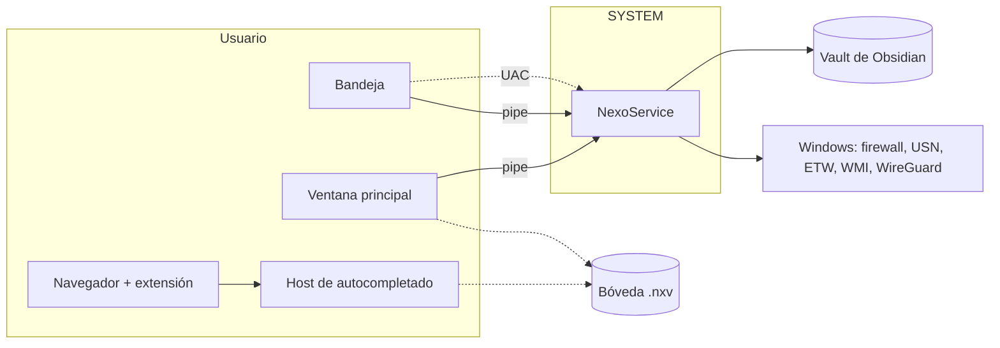

*Tipo: Concepto*

# Arquitectura general

Nexo son **tres procesos** que hablan por un pipe, más un navegador:

- La **ventana** y la **bandeja** nunca tocan el sistema por su cuenta: piden al servicio ([Pipe IPC y su ACL](Pipe%20IPC%20y%20su%20ACL.md)).
- Todo cambio sigue el mismo camino de dos pasos ([Vista previa, token y aprobación](Vista%20previa%2C%20token%20y%20aprobaci%C3%B3n.md)).
- Las funciones sensibles se activan **solo** por archivo de configuración ([Apagado por omisión](Apagado%20por%20omisi%C3%B3n.md)).
- Todo deja rastro en el vault de Obsidian ([Reportes y vault de Obsidian](../03%20Funciones/Reportes%20y%20vault%20de%20Obsidian.md)).

## Límite honesto: modo usuario
No hay driver de kernel firmado (fuera de alcance). Por eso Nexo **detecta y reacciona**, pero no puede **prevenir**. No sustituye a Microsoft Defender: lo complementa. Ver [Modo usuario y sus límites](Modo%20usuario%20y%20sus%20l%C3%ADmites.md).

## Por dónde seguir
[Mapa de proyectos](../02%20Proyectos/Mapa%20de%20proyectos.md) · [Mapa de funciones](../03%20Funciones/Mapa%20de%20funciones.md) · [Mapa de interfaces](../04%20Interfaces/Mapa%20de%20interfaces.md) · [Servicio NexoService](../03%20Funciones/Servicio%20NexoService.md)
