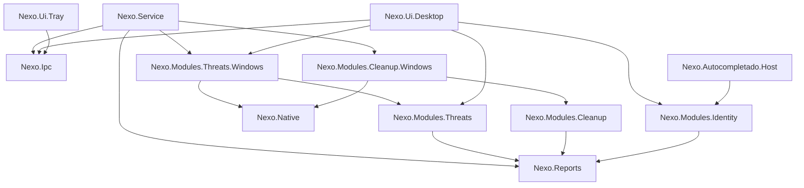

*Tipo: Proyecto*

# Mapa de proyectos

La solución `NexoAntivirus.sln` tiene 12 proyectos de producción más una extensión de navegador. Así dependen entre sí (flecha = «usa a»):

Patrón que se repite: cada área tiene un proyecto **portable** (la lógica, que se puede probar en Linux) y otro **.Windows** (lo que habla con el sistema). Por eso se hicieron pruebas en Linux de la ventana y de la lógica, y las pruebas de integración en Windows.

## Todos los proyectos
- [Nexo.Reports](Nexo.Reports.md) — 21 archivos, ~2 600 líneas
- [Nexo.Native](Nexo.Native.md) — 14 archivos, ~1 360 líneas
- [Nexo.Ipc](Nexo.Ipc.md) — 6 archivos, ~560 líneas
- [Nexo.Modules.Threats](Nexo.Modules.Threats.md) — 45 archivos, ~9 200 líneas
- [Nexo.Modules.Threats.Windows](Nexo.Modules.Threats.Windows.md) — 16 archivos, ~1 750 líneas
- [Nexo.Modules.Cleanup](Nexo.Modules.Cleanup.md) — 32 archivos, ~4 000 líneas
- [Nexo.Modules.Cleanup.Windows](Nexo.Modules.Cleanup.Windows.md) — 7 archivos, ~630 líneas
- [Nexo.Modules.Identity](Nexo.Modules.Identity.md) — 15 archivos, ~2 200 líneas
- [Nexo.Service](Nexo.Service.md) — 25 archivos, ~4 000 líneas
- [Nexo.Ui.Desktop](Nexo.Ui.Desktop.md) — 40 archivos, ~7 400 líneas
- [Nexo.Ui.Tray](Nexo.Ui.Tray.md) — 11 archivos, ~1 500 líneas
- [Nexo.Autocompletado.Host](Nexo.Autocompletado.Host.md) — 2 archivos, ~130 líneas
- [Nexo.Autocompletado.Extension](Nexo.Autocompletado.Extension.md) — JavaScript + manifest

Ver también [Arquitectura general](../01%20Arquitectura/Arquitectura%20general.md) y [Pruebas y verificación](../01%20Arquitectura/Pruebas%20y%20verificaci%C3%B3n.md).
