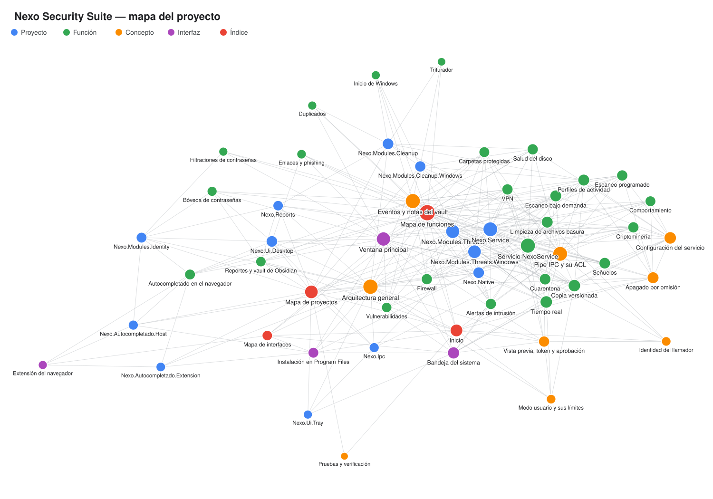

# Nexo Security Suite — mapa del proyecto

Suite de higiene y monitoreo de seguridad para **Windows 10/11**. Complementa a Microsoft Defender; no lo reemplaza. Proyecto personal, 100 % gratuito.

*Cada nodo es una nota; cada línea, un enlace entre ellas. Los nodos grandes son los más conectados.*

## Cómo usar esta bóveda
Abre la **vista de grafo** de Obsidian (Ctrl+G). Los colores separan los tipos de nota:
- 🟦 **proyecto** — un proyecto de la solución ([Mapa de proyectos](02%20Proyectos/Mapa%20de%20proyectos.md))
- 🟩 **funcion** — qué hace la app ([Mapa de funciones](03%20Funciones/Mapa%20de%20funciones.md))
- 🟧 **concepto** — cómo está pensada ([Arquitectura general](01%20Arquitectura/Arquitectura%20general.md))
- 🟪 **interfaz** — ventana, bandeja, extensión ([Mapa de interfaces](04%20Interfaces/Mapa%20de%20interfaces.md))

Una buena forma de recorrerla: empieza por [Arquitectura general](01%20Arquitectura/Arquitectura%20general.md), sigue por [Vista previa, token y aprobación](01%20Arquitectura/Vista%20previa%2C%20token%20y%20aprobaci%C3%B3n.md) (el flujo central) y entra a cualquier función desde [Mapa de funciones](03%20Funciones/Mapa%20de%20funciones.md).

## Lo esencial en cinco ideas
1. **Tres procesos** hablan por un pipe: ventana, bandeja y servicio ([Pipe IPC y su ACL](01%20Arquitectura/Pipe%20IPC%20y%20su%20ACL.md)).
2. **Todo cambio** va con vista previa, token y aprobación UAC ([Vista previa, token y aprobación](01%20Arquitectura/Vista%20previa%2C%20token%20y%20aprobaci%C3%B3n.md)).
3. Las protecciones sensibles **nacen apagadas** y solo se activan por archivo ([Apagado por omisión](01%20Arquitectura/Apagado%20por%20omisi%C3%B3n.md)).
4. El servicio actúa con **la identidad de quien pide** ([Identidad del llamador](01%20Arquitectura/Identidad%20del%20llamador.md)).
5. Todo queda en notas de Obsidian ([Reportes y vault de Obsidian](03%20Funciones/Reportes%20y%20vault%20de%20Obsidian.md), [Eventos y notas del vault](01%20Arquitectura/Eventos%20y%20notas%20del%20vault.md)).

## Dónde está el código
Repositorio `raideersit/nexo-security-suite`, rama `main`. Esta bóveda es una **fotografía documentada** (2026-11-15); no se actualiza sola.

También: [Modo usuario y sus límites](01%20Arquitectura/Modo%20usuario%20y%20sus%20l%C3%ADmites.md) · [Pruebas y verificación](01%20Arquitectura/Pruebas%20y%20verificaci%C3%B3n.md) · [Instalación en Program Files](04%20Interfaces/Instalaci%C3%B3n%20en%20Program%20Files.md) · [Configuración del servicio](01%20Arquitectura/Configuraci%C3%B3n%20del%20servicio.md)

---
*Estas páginas son una copia para GitHub de la bóveda de Obsidian del proyecto (los `[[enlaces]]` de Obsidian se convirtieron en enlaces normales). La fotografía es del 2026-11-15.*